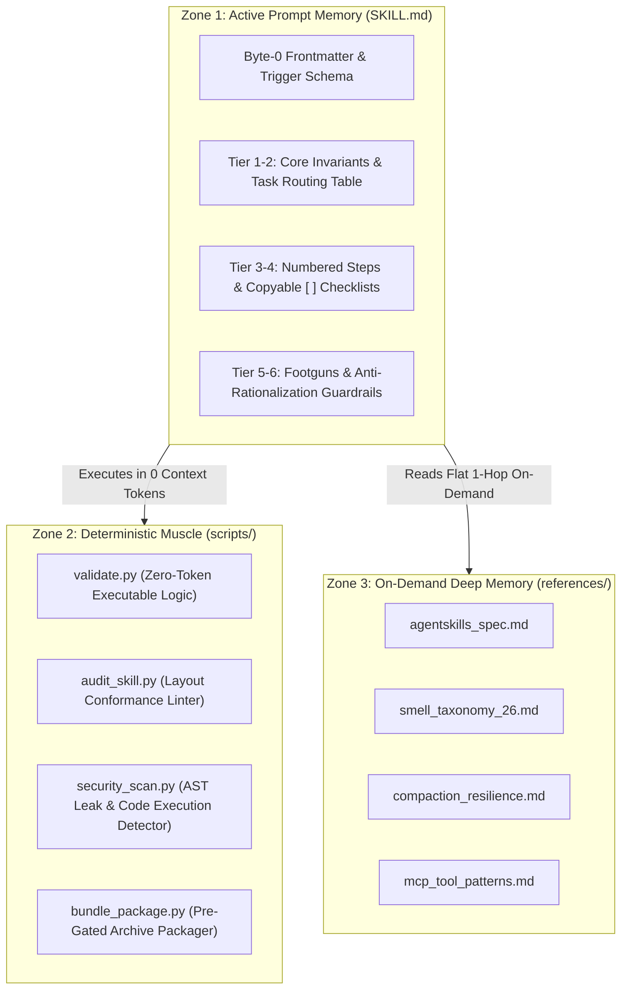

# ⚡ Universal Skill Creator (v1.0)

[](LICENSE)
[](https://agentskills.io)
[](#-interactive-cli-toolkit)
[](#-interactive-cli-toolkit)
[](https://python.org)
[](#-empirical-proof--built-example)
[](#)

> **The open-source meta-skill factory that synthesizes, audits, benchmarks, and packages enterprise AI Agent Skills.**

Turn raw practitioner notes, books, transcripts, SOPs, or competitor teardowns into institutional-grade, zero-defect agent skills adhering strictly to the open **[agentskills.io](https://agentskills.io)** standard.

---

## 🎯 The Problem: Why 95% of AI Skills Fail in Production

Modern frontier LLMs and reasoning architectures (Claude 5x series, GPT-5 / o-series, Gemini 3.8 Flash / Argon) are incredible, but unstructured prompt-only skills fail in production due to 4 core architectural flaws:

1. **Context Compaction Shearing**: Monolithic prompt files (>500 lines) suffer attention degradation. When conversational context triggers auto-compaction, instructions placed deep in prompts are permanently sheared off.
2. **Missing Utility Scripts (MUS - #1 Failure Mode)**: Models hallucinate when attempting syntax checking, regex parsing, math, or AST diffs inside token memory.
3. **The Option Buffet (TOB)**: Prompts that list 5 different tools without an opinionated default routing table cause model decision paralysis.
4. **Rationalization Loopholes (RL)**: Without an explicit Anti-Rationalization Table, models rationalize cutting corners and skipping validation steps whenever tasks become complex.

---

## 🏆 The Solution: Three-Zone Hybrid Architecture

Universal Skill Creator enforces a strict **Three-Zone Separation of Concerns**:



* **Zone 1 (Under 200 lines)**: Lean procedural operating system optimized for context compaction survival.
* **Zone 2 (Zero Context Tokens)**: Companion Python scripts execute deterministic math, syntax, and schema verification gates.
* **Zone 3 (Flat 1-Hop Deep)**: Deep reference playbooks read on-demand only when relevant.

---

## 🚀 Quick Start (Install in 30 Seconds)

Clone directly into your AI environment's skill directory:

### Claude Code CLI
```bash
git clone https://github.com/your-username/universal-skill-creator.git ~/.claude/skills/universal-skill-creator
```

### Cursor IDE
```bash
git clone https://github.com/your-username/universal-skill-creator.git .cursor/skills/universal-skill-creator
```

### Google Antigravity
```bash
git clone https://github.com/your-username/universal-skill-creator.git ~/.gemini/config/skills/universal-skill-creator
```

### Windsurf & OpenAI Codex
```bash
git clone https://github.com/your-username/universal-skill-creator.git ./skills/universal-skill-creator
```

---

## ⚡ How to Trigger

In your AI chat (Claude Code, Cursor, Antigravity, or Windsurf), simply prompt:

```markdown
Create an enterprise AI skill for [Workflow / Domain].
Here are my practitioner notes / SOP / transcripts:
[Paste text, attach files, or specify repo path]
```

### What Happens Automatically
```
Inputs (Notes / SOPs / Transcripts)
  ├── Phase 0: Competitor teardown & domain lexicon extraction
  ├── Phase 1: Silent environment & MCP tool discovery
  ├── Phase 2: Silent repository inspection & zero-slop triage
  ├── Phase 3: Three-Zone authoring (SKILL.md + scripts/validate.py + references/)
  ├── Phase 4: Zero-token AST security scan & layout conformance audit (100/A+)
  └── Phase 5: Trigger recall/precision evaluation & leak-proof packaging
```

---

## 🛠️ Interactive CLI Toolkit

All scripts are standalone standard-library Python (no dependencies required):

### 1. Structural Layout Auditor
Audits any candidate skill against layout conformance rules and unrendered `{PLACEHOLDER}` gates:
```bash
python scripts/audit_skill.py path/to/skill
```
*Outputs structured JSON with score (0-100), letter grade (A+ to F), violations, and line counts.*

### 2. AST Security & Credential Scanner
Scans Python, JavaScript, and Markdown files for dangerous execution (`eval`, `exec`, `shell=True`, remote pipes `curl | sh`) and cloud credentials (AWS, Google, OpenAI, Anthropic, GitHub, Slack, Stripe):
```bash
python scripts/security_scan.py path/to/skill
```

### 3. Dynamic Trigger Evaluator
Tests candidate skill trigger precision and negative exclusion guards against independent queries:
```bash
python scripts/test_skill_trigger.py path/to/skill
```

### 4. Pre-Gated Distribution Packager
Runs audit and security gates before bundling. Automatically aborts if any violations or active `.env` files are detected:
```bash
python scripts/bundle_package.py path/to/skill dist/ --format both
```

---

## 🧪 Empirical Proof & Built Example

Unlike prompt generators that rely on subjective claims, this repository includes an end-to-end built example:

* **Example Skill**: [`examples/built-example/prospect-homepage-audit/`](examples/built-example/prospect-homepage-audit/)
* **Companion Validator**: [`scripts/validate.py`](examples/built-example/prospect-homepage-audit/scripts/validate.py)
* **Automated Test Cases**: 10 empirical test cases in [`evals/cases.json`](evals/cases.json)

Run the automated test suite locally:
```bash
python scripts/run_evals.py .
```

```json
{
  "status": "PASS",
  "total_cases": 10,
  "passed_cases": 10,
  "pass_rate": 100.0
}
```

---

## 📁 Repository Structure

```
universal-skill-creator/
├── SKILL.md                 # Master orchestrator (179 lines, Grade A+)
├── skill.yaml               # Muse native discovery specification
├── README.md                # Documentation & Architecture overview
├── CHANGELOG.md             # Version history & verified test benchmarks
├── LICENSE                  # Apache 2.0 Open Source License
├── agents/                  # 5 Specialist Personas (Architect, Auditor, Script Smith, etc.)
├── assets/                  # Scaffolds (master_template.md, validator_template.py)
├── references/              # 16 Flat Reference Guides (compaction, baseline grading, smells, MCP)
├── scripts/                 # 16 Deterministic Python CLI utilities
├── tools/                   # Companion deployment & packaging tools
│   ├── universal-skill-installer/  # Sandboxed multi-harness installer with AST security scan
│   └── universal-skill-exporter/   # Non-mutating archive bundler with SHA256 integrity
├── evals/                   # 20 Automated task evaluation cases & trigger datasets
└── examples/                # Built reference skill & packaging gate test fixtures
```

---

## 📦 The Complete Ecosystem: Companion Tools

This repository ships with the complete skill lifecycle toolkit in `tools/`:

| Tool | Directory | Function | Primary Command |
|:-----|:----------|:---------|:----------------|
| **Universal Skill Creator** | Root | Meta-skill synthesis, 26-smell AST auditing, and trigger evaluation. | `python scripts/audit_skill.py .` |
| **Universal Skill Installer** | `tools/universal-skill-installer/` | Sandboxed multi-harness installer (`~/.gemini`, `~/.claude`, `.cursor`), AST malware scan, hidden secret setup. | `python tools/universal-skill-installer/scripts/unpack_and_scan.py <archive>` |
| **Universal Skill Exporter** | `tools/universal-skill-exporter/` | Commercial release packager (`.zip` and `.tar.gz`) with non-mutating builds, audit gates, and SHA256 hashes. | `python tools/universal-skill-exporter/scripts/bundle_package.py <skill_dir> <out_dir>` |

---

## 📜 Compliance & Standard

This skill fully adheres to the open **[agentskills.io](https://agentskills.io)** standard:
* **Byte-0 Delimiter**: Starts immediately at byte 0 with `---`.
* **Zero Angle Brackets**: Prompt-injection safe frontmatter (no `<` or `>`).
* **Compaction Resilient**: Under 200 body lines; heavy playbooks decoupled into `references/`.
* **Zero Token Cost**: Heavy logic offloaded to companion Python scripts in `scripts/`.

---

## ⭐ Star History & Contributing

If this repository helps you build reliable, institutional-grade AI agent skills, please consider **starring the repository ⭐** on GitHub!

Pull requests for new domain references, validator templates, and test cases are welcome. Please read [CONTRIBUTING.md](CONTRIBUTING.md) before submitting.

---

## 📄 License & Copyright

Copyright (c) 2026 Momin / GTM Engineering.

Distributed under the [Apache License 2.0](LICENSE). Free for individual, commercial, and enterprise use.

