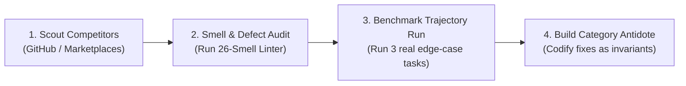

# Competitor Teardown Protocol: Engineering Category-Leading Skills

## Contents
1. The 4-Step Teardown Lifecycle
2. Systematic Search Map & Sources
3. Comparable Evaluation Matrix
4. Codifying Category-Leading Antidotes

To build a production-grade AI skill, you must prove that your skill fundamentally outperforms existing open-source skills, prompt templates, and raw frontier models.

This protocol provides the repeatable methodology for tearing down competitor offerings and engineering the market-leading antidote.

---

## 1. The 4-Step Teardown Lifecycle



### Step 1: Scout Niche Prior Art
Search for existing prompts or skills in your domain:
- **Platform repositories**: Official platform skill repositories and specifications (`agentskills.io`, Claude skills, OpenAI plugins).
- **GitHub queries**: `filename:SKILL.md <domain>`, `path:.claude/skills <domain>`, `filename:.cursorrules <domain>`.
- **Public marketplaces**: Prompt directories, open-source skill collections.
- **Practitioner forums**: User complaints, issue threads, reviews, and failed-workflow discussions to find where existing tools break.

### Step 2: Audit Competitor Defects (The 26-Smell Scan)
Run the candidate competitor through our `scripts/audit_skill.py`. To validate a structured competitive landscape record, run:
```bash
python scripts/analyze_skill_market.py path/to/landscape.json
```
Common defects in 95% of public skills:
1. **The Option Buffet (TOB)**: They say *"You can use framework A, B, C, or D"*. The model hesitates.
   * *Our Antidote*: Prescribe an opinionated, best-in-class default tool.
2. **Missing Utility Script (MUS)**: They try to enforce formatting or rules using soft prose prompt tokens.
   * *Our Antidote*: Bundle a 20-line deterministic Python verifier in `scripts/`.
3. **Rationalization Loophole (RL)**: They don't forbid excuses. When tests take long, the agent skips them.
   * *Our Antidote*: Add an explicit Anti-Rationalization Table.
4. **Context Dilution (Comprehensive Dump)**: They dumped a 2,000-line textbook into one markdown file.
   * *Our Antidote*: Keep `SKILL.md` under 450 lines; delegate to flat `references/`.

### Step 3: Run the Edge-Case Trajectory Test
Run the competitor skill on 2–3 boundary conditions or messy inputs (not just the simple happy path):
- Observe where the competitor output produces generic AI clichés ("AI slop").
- Observe where it fails on subtle edge cases or rate limits.
- Record the exact failures in your competitive audit table.

### Step 4: Codify the Category-Leading Antidote
Write the explicit antidote into your skill:
- Add the failure modes directly to your **Domain Footguns**.
- Add the required checks to your **Verification Gates**.
- Emphasize these advantages in your verification gates and domain footguns, not in a separate marketing file.

---

## 2. Comparable Evaluation Matrix

For each adjacent solution captured, score with evidence:

| Dimension | Question | Antidote Requirement |
|---|---|---|
| **Job Clarity** | Is the recurring job narrow and valuable? | Define precise input/output boundary |
| **Activation** | Can the right user find and trigger it? | Natural trigger phrases + explicit negative boundary |
| **Domain Depth** | Does it contain real language, rules, and edge cases? | Codify practitioner dialect & failure modes |
| **Workflow** | Are decisions and sequencing explicit? | Numbered phases with copyable checklists |
| **Verification** | Are outputs tested programmatically? | Deterministic Python validator in `scripts/` |
| **Safety** | Are credentials and command injections prevented? | Zero-token AST security scanner & `.env.example` |

Use references/landscape-example.json as the schema template for analyze_skill_market.py. Replace all example values with real research first, the example file itself is not research.
