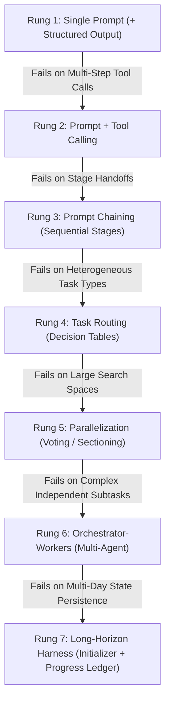

# 🧭 Decision Matrices & The Architectural Escalation Ladder (`decision_matrices_and_escalation.md`)

Derived from the empirical **LLM Agent Skills Playbook (2026)**, this reference provides non-negotiable rules for selecting between skills, MCPs, hooks, memory files, and subagents, along with the agent escalation ladder.

---

## 1. When to Use What: Selection Matrix

| Capability Needed | Correct Architectural Mechanism | Why (Empirical Rationale) | Context Token Impact | When NOT to Use |
|---|---|---|---|---|
| Rules that must apply on **every** turn ("use pnpm", "never touch production db") | **Memory File** (`AGENTS.md`, `CLAUDE.md`, `GEMINI.md`) | Persistent context injected on every session start. | Continuous baseline cost. Keep brief (<100 lines). | When content is a procedural playbook (move procedures to skills). |
| Repeatable procedure or reference needed **on demand** | **Skill** (`SKILL.md` in directory) | Only `description` loaded at startup (~100 tokens); full body read only when triggered. | Zero until triggered; progressive disclosure keeps context lean. | Tasks that must happen every single turn without exception (use a hook). |
| Direct connection to **external systems / APIs / live data** | **MCP Server** (or native tool) | Connection protocol; names loaded at start, schemas on demand. | Low until used. | When only procedural instructions are needed without external API calls. |
| Teaching an agent how to use an MCP server effectively | **Skill + MCP** | "MCP provides the connection; a skill teaches the model how to use it well." | Minimal until skill triggers. | — |
| Isolated side-task that **floods context**, or parallel research | **Subagent** (or isolated child turn) | Sandboxed context window; returns only a synthesized outcome. | Isolates large token floods from the primary conversation. | When task requires continuous step-by-step shared state. |
| Hard constraint that **must always** execute on an event (e.g. lint after edit) | **Hook / Code Gate** | Deterministic code execution; fires regardless of whether LLM remembers instructions. | Zero context cost unless it returns feedback. | When task requires qualitative model judgment. |
| One-off, ad-hoc developer question | **Plain Prompt** | Avoids unnecessary engineering overhead. | Single-turn cost. | When you paste the same playbook for a 3rd time (convert to a skill). |

---

## 2. Trigger Heuristics

- Model gets a repo convention wrong twice ──▶ **Add to `AGENTS.md` / Memory File**
- You paste the same playbook a 3rd time ──▶ **Create a `SKILL.md`**
- Agent needs access to external data it cannot see ──▶ **Configure an MCP Server**
- Secondary task floods or pollutes the main chat ──▶ **Dispatch a Subagent**
- Action must execute 100% of the time on an event ──▶ **Enforce via a Hook / Python Code Gate**
- Workflow needs cross-repo or team distribution ──▶ **Package into an `agentskills.io` Skill**

---

## 3. The Architectural Escalation Ladder

Always use the **simplest architectural mechanism that reliably satisfies your acceptance criteria**. Move up one rung only when an empirical evaluation reveals a failure mode that the lower rung cannot solve.

### Rung Guidelines:
1. **Rung 1 (Single Prompt)**: Direct instructions with JSON schema. Lowest latency and cost.
2. **Rung 2 (Tool Calling)**: Single prompt equipped with dedicated tools.
3. **Rung 3 (Prompt Chaining)**: Fixed sequential stages with programmatic gates between calls.
4. **Rung 4 (Task Routing)**: Router evaluates intent and delegates to a scenario-specific sub-workflow.
5. **Rung 5 (Parallelization)**: Independent subtasks executed simultaneously with a synthesis reducer.
6. **Rung 6 (Orchestrator-Workers)**: Lead coordinator delegates to isolated subagents (~15× token spend; reserve for high-value research or multi-file coding).
7. **Rung 7 (Long-Horizon Harness)**: Persistent progress tracking (`passes` flags, git commits, browser automation verification) spanning multiple hours or sessions.
