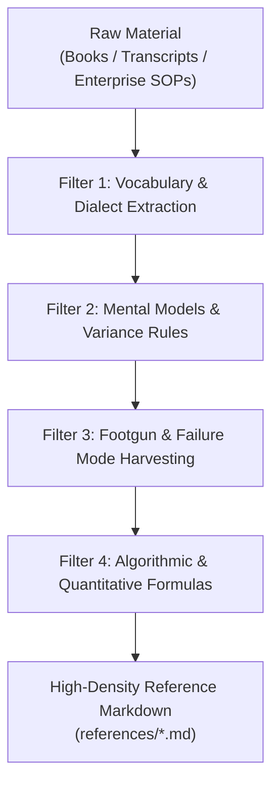

# Domain Knowledge Ingestion Protocol: Turning Raw Literature into High-Value Production Assets

## Contents
1. Source Hierarchy & Ingestion Priority
2. The 4-Layer Extraction Filter
3. Extraction Passes & Dialect Harvesting
4. Knowledge Architecture Mapping

A commercial-grade AI skill derives 90% of its value from **concentrated domain IP**. This protocol details how to extract, condense, and codify messy source materials (books, transcripts, enterprise SOPs, whitepapers) into high-performance skill packages.

---

## 1. Source Hierarchy & Ingestion Priority

When gathering domain knowledge, strictly prioritize sources in this order:

1. **User-Owned SOPs & Transcripts**: Primary workflows, internal playbooks, recorded expert calls, approved outputs.
2. **Primary Documentation & Current Specifications**: Official APIs, protocol specs, architecture whitepapers.
3. **First-Party Case Studies & Postmortems**: Real projects with documented edge cases, failures, and recovery paths.
4. **Practitioner Interviews & High-Signal Podcasts**: Unscripted operator discussions revealing non-obvious footguns.
5. **Secondary Commentary / Generic Articles**: Use only as leads, never as authoritative domain ground truth.

---

## 2. The 4-Layer Extraction Filter

When processing raw text (e.g. a business book or an expert transcript), pass the content through 4 progressive filters:



### Layer 1: Vocabulary & Dialect Extraction
- **Rule**: Eliminate generic synonyms. Replace general words with domain-standard jargon.
- *Bad (Generic AI)*: "We make sure the customer is a good fit."
- *Good (B2B SaaS Dialect)*: "Enforce strict ICP qualification: minimum $5M ARR, 50+ sales reps, using Salesforce + Outreach."

### Layer 2: Mental Models & Variance Rules
- Extract the core conceptual reframings that change how the LLM approaches the task.
- *Example (from Anthropic docx)*: *"A .docx is a ZIP archive of XML files."*
- *Example (from B2B Copywriting)*: *"A cold DM is not an elevator pitch; it is a permission ladder designed only to earn a 1-sentence reply."*

### Layer 3: Footgun & Failure Mode Harvesting (The Highest-Value IP)
- Scan transcripts and literature specifically for **what fails, what breaks, and what gets people fired or penalized**.
- These become entries in your skill's `Domain Footguns` and `Anti-Rationalization Table`.
- *Example*: In LinkedIn growth, the footgun is editing a post within the first 10 minutes (which cuts algorithm reach by 50%).

### Layer 4: Algorithmic & Quantitative Formulas
- Find measurable numbers, ratios, and thresholds.
- Convert qualitative guidelines into hard metrics:
  - *Hook character length*: 120–180 characters max before the "...see more" cutoff.
  - *Reading grade level*: Flesh-Kincaid Grade 5–7.
  - *Ratio*: 80% educational insight / 20% call-to-action.

---

## 3. Extraction Passes & Candidate Lexicon Generation

To rapidly harvest vocabulary from transcripts and text archives:
1. Run the domain lexicon extractor:
   ```bash
   python scripts/build_domain_lexicon.py path/to/transcript.txt --output evals/lexicon.json
   ```
2. Review extracted high-frequency terms. Separate buyer/practitioner phrases from generic programming words.
3. Every important term needs: plain meaning, condition of use, and common misconception.

---

## 4. Where Ingested Knowledge Belongs

To respect the **6-Tier Compaction-Resilient Architecture** and avoid context bloat:

| Type of Ingested Knowledge | Destination in Skill Package |
|:---------------------------|:-----------------------------|
| Core Mental Model & Top 2 Invariants | `SKILL.md` (Tokens 1–500) |
| Primary Task Routing Table | `SKILL.md` (Tokens 500–1,000) |
| Top 3–5 Critical Footguns | `SKILL.md` (Tokens 3,000–4,200) |
| Anti-Rationalization Guardrails | `SKILL.md` (Tokens 3,000–4,200) |
| Deep Industry Playbooks & Frameworks | `references/<framework>.md` (Loaded on demand, 1 hop deep) |
| Formula / Metric Validation Logic | `scripts/validate.py` (0 context tokens) |
| Concrete Output Templates | `assets/templates/` |
