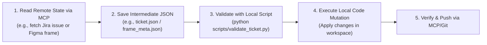

# Model Context Protocol (MCP), APIs & Secrets in Agent Skills

## Contents
1. Choosing the Right Tool Integration: API Keys vs. MCP Servers
2. Safe API Key Handling Pattern
3. MCP Tool Composition Pattern
4. Graceful Degradation Matrix

A skill provides **procedural knowledge**, not system permissions. Instructions in `SKILL.md` teach an agent how to compose tools it already possesses: local shell commands, external API keys, or pre-connected MCP tools.

---

## 1. Choosing the Right Tool Integration: API Keys vs. MCP Servers

When building an enterprise skill that communicates with external systems, choose the appropriate integration layer based on the architecture:

| Dimension | External REST API (`requires_secrets` + `.env`) | Model Context Protocol (MCP Server) |
|:----------|:------------------------------------------------|:-------------------------------------|
| **Best For** | Standalone web scraping (Apify), single API calls (OpenAI, Serper, RapidAPI, Stripe). | Deep, stateful local/cloud integration (Figma, GitHub, Postgres, Chrome DevTools). |
| **Authentication** | API Key stored in project's `.env` file. Loaded via `load_env()` in `scripts/`. | Managed by the host application's MCP configuration (`mcp_config.json`). |
| **Declaration in SKILL.md** | Declared in frontmatter under `requires_secrets:` with signup URLs and hints. | Declared under tool instructions and preconditions (`mcp <server> <tool>`). |
| **Client Experience** | Client copies `.env.example` to `.env` and pastes their key. | Client connects MCP server via the IDE's plugins/MCP manager. |

---

## 2. Safe API Key Handling Pattern (`requires_secrets` + `load_env()`)

When an external API key is required:

### A. Frontmatter Declaration
```yaml
requires_secrets:
  - key: APIFY_API_TOKEN
    service: Apify Platform
    url: https://console.apify.com/account/integrations
    description: Powers the LinkedIn profile and post scraper
    hint: "Starts with 'apify_api_'"
    required: true
    instructions: |
      1. Go to console.apify.com
      2. Sign in or create an account
      3. Navigate to Settings -> Integrations -> API Tokens
      4. Copy your token and add APIFY_API_TOKEN=your_token to your .env file
```

### B. Python Script Loading Helper (`scripts/my_tool.py`)
```python
import os
import sys
from pathlib import Path

def load_env():
    """Zero-dependency .env loader walking 10 parent directories."""
    current = Path(__file__).resolve()
    for _ in range(10):
        current = current.parent
        env_path = current / ".env"
        if env_path.is_file():
            try:
                with open(env_path, "r", encoding="utf-8") as f:
                    for line in f:
                        line = line.strip()
                        if line and not line.startswith("#") and "=" in line:
                            k, v = line.split("=", 1)
                            os.environ.setdefault(k.strip(), v.strip().strip('"\''))
                return True
            except Exception:
                continue
    return False

load_env()
token = os.environ.get("APIFY_API_TOKEN")
if not token:
    print("Error: Missing APIFY_API_TOKEN in .env. See SKILL.md requires_secrets for setup instructions.", file=sys.stderr)
    sys.exit(1)
```

---

## 3. Discovered MCP Tools vs. Hardcoded Assumptions

> [!CAUTION]
> **Never Hallucinate MCP Servers or Tools**:
> - Only instruct the agent to call an MCP tool if that server/tool was verified during the environment discovery phase (`scripts/discover_env.py`).
> - If an MCP tool is required but missing, instruct the agent to notify the user and offer an alternative CLI command or fallback script.

---

## 4. Standard MCP Wiring Patterns

### Pattern A: Design Systems (Figma MCP)
```markdown
### Step 1: Design Context Discovery
1. Request screenshot and design context via `get_design_context`:
   `mcp figma get_design_context fileKey="FILE_KEY" nodeId="NODE_ID"`
2. If response is sparse, batch-request visible child node IDs in parallel.
```

### Pattern B: Database & Backend (Postgres / SQL MCP)
```markdown
### Step 1: Schema Discovery
1. Query table schema before drafting queries:
   `mcp postgres describe_table table_name="users"`
2. Verify existing indexes and constraints before proposing migrations.
```

### Pattern C: Version Control & CI/CD (GitHub MCP)
```markdown
### Step 1: Triage PR Status
1. Check CI check runs and pending reviews:
   `mcp github get_pull_request_status owner="ORG" repo="REPO" pull_number=123`
```

---

## 5. Combining MCP Tools with Deterministic Scripts (Zone 1 / Zone 3)

The most resilient pattern pairs an MCP read with a local validation script:


