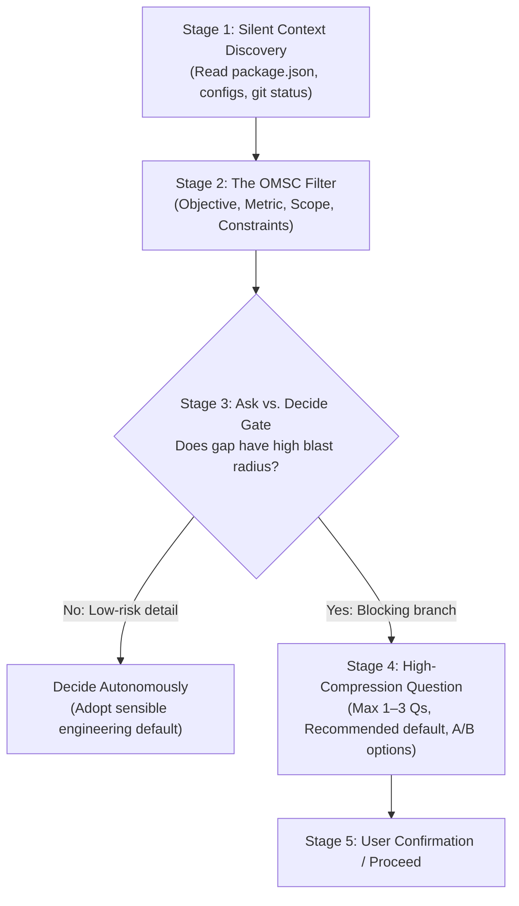

# The 5-Stage Ambiguity Triage & OMSC Decision Protocol

Determining whether an agent should execute immediately or pause to ask questions is critical. Silent assumptions hide dangerous bugs; lazy questions cause interrogation paralysis.

---

## 1. The 3 Question-Handling Archetypes

| Dimension | Archetype 1: Pre-Execution Gatekeeper | Archetype 2: Generate-First, Flag Inline | Archetype 3: Sequential Interviewer |
|:----------|:--------------------------------------|:-----------------------------------------|:------------------------------------|
| **When to Use** | Ambiguous requests with high blast radius, destructive DB migrations, or mutually exclusive architecture choices. | Low blast radius, reversible tasks, document drafting, single-file edits. | Greenfield spec drafting, PRD authoring, system brainstorming. |
| **Pre-Action** | Silent discovery first; pauses execution if blocking unknowns remain. | Silent discovery; adopts sensible defaults for all gaps and executes artifact. | Refuses to generate final files until discovery rounds complete. |
| **Questions Asked** | 1 to 3 compact questions maximum, paired with `(Recommended)` defaults. | 0 questions. Flags assumptions in a summary block for easy user override. | 1 question at a time in sequence (3–5 rounds total). |

---

## 2. The 5-Stage Triage Protocol

### Stage 1: Silent Context Discovery (MANDATORY)
Before formulating any question to the user:
- Read local configuration files (`package.json`, `tsconfig.json`, `pyproject.toml`, `.env.example`).
- Inspect directory trees and existing conventions.
- Never ask a question that repository files can answer in 2 seconds.

### Stage 2: The OMSC Filter
Evaluate remaining gaps against four dimensions:
1. **Objective**: What behavior must change vs. stay identical?
2. **Metric / Acceptance**: What concrete condition defines "done"?
3. **Scope**: Which files, modules, or endpoints are in vs. out of bounds?
4. **Constraints & Safety**: Compatibility targets, data migration reversibility, performance limits.

### Stage 3: Ruthless Ask vs. Decide Gate
- **NEVER ASK**: Implementation details (algorithms, variable names, debounce ms, internal helper structure). Decide autonomously.
- **NEVER ASK**: Facts verifiable from the workspace.
- **ONLY ASK**: Mutually exclusive architectural choices, destructive operations (DROP/DELETE), or contradictory user instructions.

### Stage 4: High-Compression Question Formatting
When asking blocking questions:
- Maximum **1 to 3 questions** at a time.
- Place `(Recommended)` on the primary default option.
- Explain the trade-off of each option in one brief sentence.
- Allow single-line shorthand replies (e.g. `1a 2b`).

### Stage 5: Conflict Resolution
If user instructions conflict with established repository standards, explicitly highlight the contradiction and ask which priority governs before mutating code.

